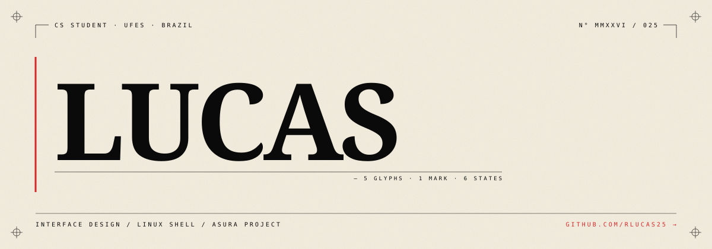

<!--

-->

  <!--
  <samp>
    <h2>
      Hi there !, I am Lucas Rebouças  👋
    </h2>
  </samp>
  -->
  

  
  
  

 
 

<samp><h4>> I am a Brazilian Computer Science student at UFES.</h4></samp>
<samp><h4>> I’m currently studying interface design and building a custom Linux desktop shell.</h4></samp>
  
<samp><h4>> Asura Shell is currently in progress...</h4></samp>

 
 
 
 

  <samp><h3><b> My Stack </b></h3></samp>
    
  
  
  
  
  
  
  
  
  
  
  
  
  
  
  
  
  
  
  
  
  
  

###  
 

  <samp><h3><b> Contact me </b></h3></samp>
    
  
  

###

  

---

<table border="0" align="center" width="80%">
  <tr>
    <td valign="top" width="60%">

### what

Computer Science student at UFES, exploring desktop environments and neural network.

### now

Developing [Asura Shell](https://github.com/rlucas25/ASURA-linux) — a custom Linux desktop environment, alongside studies in software architecture and algorithms.

### focus

Operating systems, UI/UX interaction, C/C++, Python, and desktop shell design.

    </td>
    <td valign="top" width="40%" align="right">
      
<strong>SELECTED</strong> 
      <code>01</code> &nbsp; <a href="https://github.com/rlucas25/ASURA-linux">Asura-linux</a> 
      <code>02</code> &nbsp; <a href="https://github.com/rlucas25/File-compressor">File-compressor</a> 
      <code>03</code> &nbsp; <a href="https://github.com/rlucas25/BPlusTree-HRM">BPlusTree-HRM</a>

      
<strong>FIND</strong> 
      <a href="https://github.com/rlucas25">github.com/rlucas25</a> 
      <a href="https://www.linkedin.com/in/lucas-rebou%C3%A7as-06b7b6255">LinkedIn</a> 
      <a href="mailto:lucasss.contact@gmail.com">lucasss.contact@gmail.com</a>

    </td>
  </tr>
</table>

###

 
 
 
 

<picture>
  <source media="(prefers-color-scheme: dark)" srcset="https://raw.githubusercontent.com/rlucas25/rlucas25/output/pacman-contribution-graph-dark.svg">
  <source media="(prefers-color-scheme: light)" srcset="https://raw.githubusercontent.com/rlucas25/rlucas25/output/pacman-contribution-graph.svg">
  
</picture>
